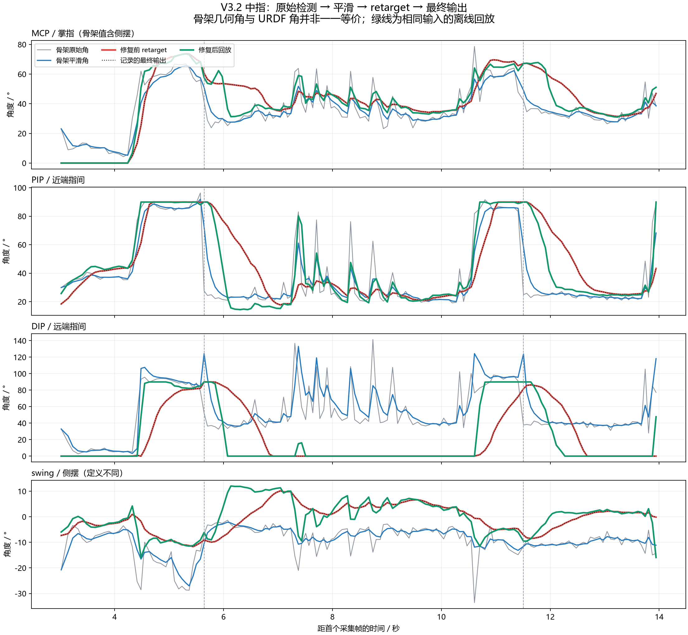
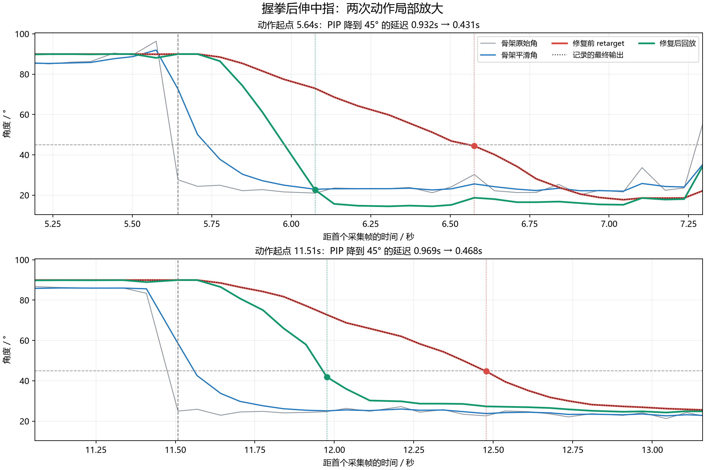

# V3.2 中指伸展延迟分析（2026-09-17）

主要问题是 retarget 初始化阶段、拓扑阶段都过度依赖上一帧姿态。快速伸指时，求解器连续多帧维持弯曲解，再缓慢追上输入。已为 V3.2 单独调整历史姿态权重与迭代次数；同一段数据的两次 PIP 响应时间各缩短约 0.50 秒。

## 数据与复现

输入：`online_control/online_motion_track/pipeline_v3_2/logs/session_20260917_111142_248015_0539c5.jsonl`，左手，相机 0，关键点平滑开启，碰撞 `monitor`。
共 250 帧、15.221 秒，其中 149 帧成功 retarget；其余帧未进入本次求解比较。
记录的 URDF、标定 SHA 与当前文件一致。先用原始默认参数逐帧回放保存的 `topo_input_points_21_m`，20 个关节与日志的最大误差为 **0 rad**，确认复现了同一个问题。
随后只改求解参数，输入关键点、模型、标定、手别和帧序保持一致。

## 曲线与响应时间



灰色为原始 world 点计算的几何角；蓝色为平滑后的几何角；红色为原 retarget；黑色虚线为日志最终输出；绿色为修复后离线回放。
人手 MCP 几何角包含侧摆，swing 的参考轴也不同，因此不能把所有曲线的绝对角度偏差解释为标定错误。



比较从原始骨架 PIP 降到 45° 开始，到对应曲线连续三个有效样本低于 45° 的首个样本，时间基于记录的采集时间戳。45° 是统一比较阈值，不代表完全伸直。

| 动作 | 起点 | 骨架平滑延迟 | 原模型响应 | 修复后回放 | 缩短 |
|---|---:|---:|---:|---:|---:|
| 第一次伸中指 | 5.644 s | 0.132 s | 0.932 s | 0.431 s | 54% |
| 第二次伸中指 | 11.508 s | 0.060 s | 0.969 s | 0.468 s | 52% |

若采用更接近伸展的 30° 阈值，两次模型响应时间由 1.127/1.302 s 降到 0.431/0.702 s。
这是相对于检测角变化的响应指标，包含关键点平滑与模型拟合差异。没有视频/真实关节角或显示呈现时间戳，不能据此测得真实手指到屏幕的完整延迟。

## 原因定位

1. **主要原因：连续两阶段的历史姿态约束。** `TsenseI_retargeting/toporetarget.py` 的初始化残差包含 `sqrt(lambda_smooth) * (q - q_prior)`，拓扑残差包含 `sqrt(lambda_reg) * (q - q_prev)`。两者原来均为 2.5，且初始化只迭代一次、拓扑只迭代两次。握拳后的历史解持续牵制当前解，快速伸展出现长拖尾。
2. **关键点平滑有次要影响。** 这两次 PIP 平滑阈值延迟为 60–132 ms，解释不了原来接近一秒的模型响应。
3. **这段数据不是碰撞修正导致的。** 全部成功帧的 `output_joint_angles` 与 `retarget_joint_angles` 完全相同，且本次为 monitor 模式。
4. **不能把一秒拖尾当成一秒计算耗时。** 本机最后一次相同输入回放，单帧求解中位耗时约 13 ms（旧）/18 ms（新）；主要问题是跨帧的数值响应。相机、检测、显示的额外耗时不在这个回放计时里。

参数对照实验（同一录制输入，两次 PIP 45° 响应秒数）：

| 改动 | 第一次 | 第二次 |
|---|---:|---:|
| 原参数 | 0.932 | 0.969 |
| 仅将初始化/拓扑迭代增加到 4/6 | 0.728 | 0.761 |
| 仅将两个历史权重降到 0.1 | 0.491 | 0.403 |
| 最终配置：两个权重 0.1，迭代 2/3 | 0.431 | 0.468 |
| 仅关闭交互图 EMA | 0.995 | 1.030 |

更多迭代并非总是让每个动作更快，因为优化目标同时考虑整只手拓扑及骨方向，并不是逐个关节直接复制人手角度。完全去掉历史先验、继续增大迭代次数等试验会使输入波动更明显，未采用。

## 已做的修复

- `assets/hands/TsenseI_hand_v3_2/hand_profile.yaml`：`lambda_smooth: 0.1`、`lambda_reg: 0.1`、`init_max_iters: 2`、`topo_max_iters: 3`。
- `src/hand_profiles.py`：读取模型独立求解参数，拒绝通过参数覆盖 URDF/标定资产；实时求解不再生成未使用的完整 FK/loss 附加结果。
- `tools/prepare_hand_v3_2.py`：新建 V3.2 配置时带上修复参数，仍保留已有配置的保护行为。
- `online_control/online_motion_track/pipeline_v3_2/recording.py`：新日志保存实际 `retarget_config`。
- `online_control/online_motion_track/pipeline_v3_2/analyze_middle.py`：可复用的曲线、回放和响应分析工具。

模型、用户标定和原始记录未修改，V2 求解默认参数未修改。重启 V3.2 入口即可生效：

```powershell
python online_control/online_motion_track/pipeline_v3_2/main.py --hand-side left --camera 0
```

## 验证与剩余限制

原有采集、记录、左右手模型、碰撞与初始化相关测试 34 项通过；新增响应回归 4 项通过，更新后的记录测试也已重跑通过。
左右手分别用模型 FK 构造“握拳→只伸中指”的理想阶跃输入：修复后第二个样本的中指 MCP/PIP/DIP 均在目标 5° 以内；原参数第二个样本仍偏差超过 30°。固定输入尾段稳定，所有输出在 URDF 限位内。

真人记录在“伸直”区间仍有 PIP 约 20–25°、DIP 约 35–40° 的几何弯曲量，7–9 秒附近还有原始骨架尖峰。因此零角度与手指真实姿态是否吻合，还受检测、遮挡、标定和模型几何影响；目前没有图像证据来判断是哪一种。降低历史约束后这些输入尖峰也更容易体现在模型上。
关键点平滑、图稳定和小的历史先验仍保留。修复显著缩短本段记录中的拖尾，尚未声称零延迟；真实相机界面效果需用重启后的同一动作确认。

附件：[完整角度 CSV](middle_angles.csv)、[统计及完整配置](metrics.json)、[全程 PDF](middle_curves.pdf)、[局部 PDF](middle_extension_zoom.pdf)。
