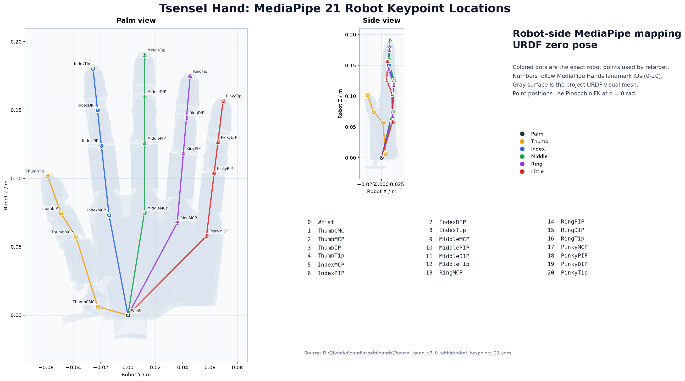
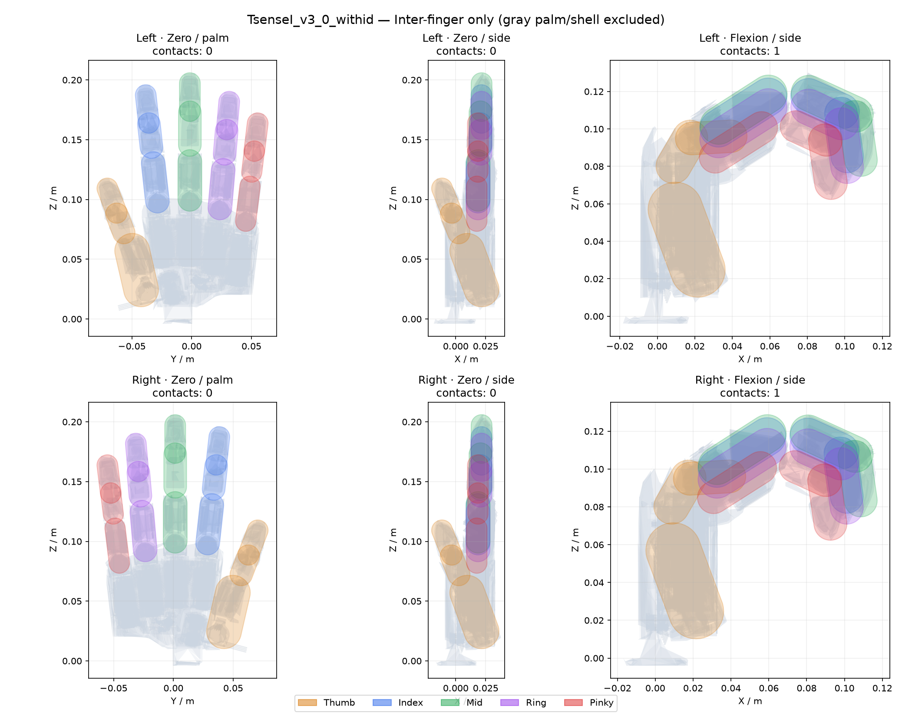

# A3.0 with ID 独立模型接入

2026-09-23。本次只修改本地项目，未部署或重启 node0。

## 型号与资源

按项目统一命名要求，新目录为 `assets/hands/TsenseI_hand_v3_0_withid`，型号 ID 为 `TsenseI_v3_0_withid`；旧型号 `TsenseI_v3_0` 保留。

| 项目 | 旧 A3.0 | A3.0 with ID |
|---|---|---|
| 源 URDF | `TsenseI_A3.0_hand/urdf/V6 26.8.4.urdf` | `TsenseI_A3.0_hand_withid/urdf/A3-2691-1053yw1.urdf` |
| 资源目录 | `assets/hands/TsenseI_hand_v3_0` | `assets/hands/TsenseI_hand_v3_0_withid` |
| 网页选择 | A3.0 | A3.0 with ID |
| 活动关节 | 20 | 20 |
| 手势标志点 | 独立的已有标定 | 独立的 21 点新几何初值，待人工确认 |
| 碰撞 | 保留原配置 | 15 个指节胶囊体，仅不同手指之间 |
| 动作文件 | `motions_a30_left/right.json` | `motions_a30_withid_left/right.json` |
| 下发换算 | 共用 A3.0 换算及编码 | 共用同一代码，保留独立型号标识 |

使用的是当前已修复、已对齐关节坐标系的带 ID 源模型，不是原始压缩包或备份。两者关节原点、转轴、父子关系及角度上下限相同；视觉几何、惯量、URDF effort/velocity 不同。没有把新 URDF 的 effort/velocity 自动当作硬件轨迹限速。右手由左手沿 XZ 平面镜像，尚非独立实测右手 CAD。

`Empty_Link*.STL` 的编号属于 CAD 网格标识，不用于推断 USB 电机槽位。USB 仍使用已对齐的功能关节名与原 A3.0 通道表：9 路直线、11 路旋转。直线负号、外接电机减速比、CRC、串口时序、找零和停止流程共用原代码。

## 旧模型名称已写入源文件

此前在资源生成阶段用代码重命名，并不是网页运行时临时改名。现在源 URDF 的关节名、连杆名及父子引用直接使用功能名称：

| 历史小指名称 | 当前名称 |
|---|---|
| rotaback | MCP |
| MCP | swing |
| swing | PIP |
| PIP | DIP |

源目录下控制器关节列表与 CAD CSV 标识也已同步。STL 文件名保持原 CAD 名称，通过 URDF 引用，不再承担关节语义。生成器和坐标系同步工具已取消二次重命名。已有资源中的关键点坐标没有重置。原始源 URDF 备份在 `backups/a30_source_names_before_canonical.urdf`。

## 21 点标定：已重新建档，人工校准尚待完成

21 个点是 MediaPipe 手势标志点，不是 21 个电机。此次没有复用旧 A3.0 的人工标定坐标。

- 0：根据新模型两块掌壳网格的近腕区域生成初始点，绑定 `base_link`。
- 1–4：拇指 CMC、MCP、IP 关节中心代理及新指尖几何点。
- 5–8、9–12、13–16、17–20：食指、中指、无名指、小指的 MCP/PIP/DIP 中心代理与新网格指尖点。
- 新模型没有 `base_link` 视觉网格，因此腕点计算会合并掌壳的所有 visual 并转换到基座坐标系。
- 左手初值保存为 `robot_keypoints_21.yaml`，右手镜像保存为 `robot_keypoints_21_right.yaml`。毫米编辑、米制落盘；每个点绑定自己的运动连杆。

当前标注为 `Draft / auto_initialized`，不是已经完成的人工标定。网页型号说明会显示“21 点待人工确认”。自动取几何中心不能确定真实皮肤表面、腕中心和人体关键点语义的最佳对应，需要在编辑器中逐点确认，尤其是腕点、拇指 CMC/IP、五个指尖及小指 MCP。



在项目根目录 PowerShell 中运行：

```powershell
# 打开新模型的独立标定文件
& E:/conda/envs/hand_dex/python.exe tools/edit_robot_keypoints_21.py --model TsenseI_v3_0_withid --hand-side left --view 3d

# 左手保存后，镜像同步右手；旧右手标注自动备份
& E:/conda/envs/hand_dex/python.exe tools/prepare_hand_v3_0_withid.py --sync-right-keypoints

# 重画标志点，检查绑定后的实际位置
& E:/conda/envs/hand_dex/python.exe tools/render_robot_keypoints_21.py --model TsenseI_v3_0_withid --output assets/hands/TsenseI_hand_v3_0_withid/qa/keypoints_left.png

# 查看模型关节运动与碰撞区域
& E:/conda/envs/hand_dex/python.exe tools/view_hand_profile.py --model TsenseI_v3_0_withid
```

人工校准后需检查张手、屈指、拇指对指、捏合四类姿态；观察关节代理是否随正确连杆移动、左右镜像是否合理。Retarget 的平滑与捏合参数以原 A3.0 为初值保存在新 profile，后续可以独立调整。不能只改 URDF 而继续使用旧模型标定结果。

## 碰撞区域



橙色为拇指、蓝色食指、绿色中指、紫色无名指、红色小指。每根手指 3 个胶囊体，共 15 个。灰色是完整视觉网格；掌部、腕部、安装外壳不生成碰撞体。指节自身外表面用于拟合指节代理，不把整只手的外壳作为一个碰撞体。

不同手指之间共 90 对几何检查；同指之间及手指对掌壳均不检查。MuJoCo、碰撞停止与 Mink 使用同一份新 MJCF。左右手张开姿态接触数为 0，图中屈指姿态接触数为 1，属于跨手指接触，不是手掌检查。

这些是用于实时计算的几何近似，并非完整网格碰撞包络。手掌碰撞按本次要求排除后，手指可以在仿真中穿入掌壳。需要调整覆盖区域时修改新模型的 `collision_geometry.yaml`，然后重新生成 MJCF 和图片：

```powershell
& E:/conda/envs/hand_dex/python.exe tools/generate_profile_collision.py --model TsenseI_v3_0_withid
& E:/conda/envs/hand_dex/python.exe tools/render_profile_collision.py --model TsenseI_v3_0_withid
```

## 项目联动修改清单

| 范围 | 已完成的修改 |
|---|---|
| 资源生成 | 新的独立生成入口、左右 URDF/网格、profile、关节分组、评估配置、初始姿态、源文件指纹 |
| 右手镜像 | 为无左右前缀的 `Empty_Link*.STL` 生成独立右手文件，避免覆盖左手 |
| 标定与可视化 | 独立 21 点文件、标定状态接口；现有标定编辑器和 profile 查看器可选择新型号 |
| 碰撞 | 独立 YAML、左右 MJCF、跨手指掩码、碰撞区域图 |
| 动作网页 | 新型号选择、资源路由、侧别切换、独立动作存储及导入校验、UI/下发范围表 |
| 手势网页 | 新型号选择、独立 solver/profile、碰撞模式、关节设置、预览流及 A3.0 控制会话 |
| 下发 | Mapper 接受型号；两个 A3.0 型号共享换算、反馈、编码与轨迹代码；浏览器紧急停止也识别新型号 |
| 日志 | 保留 with-ID 型号，防止共用遥测元数据覆盖型号；日志查看器识别两种 A3.0 |
| 打包 | 两个网页的资源白名单加入新型号与共用模型识别模块；本次未部署 |
| 校验 | 新旧关节坐标系、左右镜像、原网格字节保持、21 点独立性、跨手指碰撞、下发字节一致性、动作隔离、HTTP 资源与实际浏览器加载 |

源码中 `A30_MODEL_IDS`（Python）和 `shared/hand-models.js`（浏览器）区分“同协议型号族”与“独立资源型号”。以后修改 A3.0 下发算法无需再复制一份给 with-ID。

## 重新生成与本地检查

```powershell
# 保留同源的人工标定；源几何改变时先备份整个新型号资源目录
& E:/conda/envs/hand_dex/python.exe tools/prepare_hand_v3_0_withid.py
& E:/conda/envs/hand_dex/python.exe tools/generate_profile_collision.py --model TsenseI_v3_0_withid

# 两个服务自检，不连接物理串口
& E:/conda/envs/hand_dex/python.exe online_control/online_motion_track/main.py --check
& E:/conda/envs/hand_dex/python.exe online_control/online_motion_play/server.py --check

# 手势网页：启动后选择 A3.0 with ID，或直接访问下方地址
& E:/conda/envs/hand_dex/python.exe online_control/online_motion_track/main.py --port 8766
# http://127.0.0.1:8766/?model=TsenseI_v3_0_withid

# 动作网页：另开终端运行，然后在模型框选择 A3.0 with ID
& E:/conda/envs/hand_dex/python.exe online_control/online_motion_play/server.py --port 8765 --no-browser
# http://127.0.0.1:8765/
```

若端口已有服务，先在对应终端停止该服务再启动，避免误以为旧进程已加载新代码。本次浏览器验证使用临时端口和独立数据目录，验证结束已关闭。没有连接实机；USB 速率和实机几何标定不属于这些离线验证的结论。

## 本次验证结果

- 270 项 Python 检查通过，覆盖原 A3.0、with-ID、A3.2、动作编辑及下发回归。
- 43 项 JavaScript 检查通过，覆盖串口协议、停止、启动条件与 with-ID 型号保留。
- 实际 Chrome 无头浏览器验证：手势页左/右手、动作页 with-ID 模型加载均通过，无页面异常或 HTTP 错误。
- 两个服务 `--check` 通过；源 CAD 验证器检查 101 组姿态，关节坐标系与旧 A3.0 完全一致。
- 原 A3.0 与新型号同姿态下发字节一致；左右新网格不互相覆盖；碰撞检查只包含 90 对不同手指组合。
