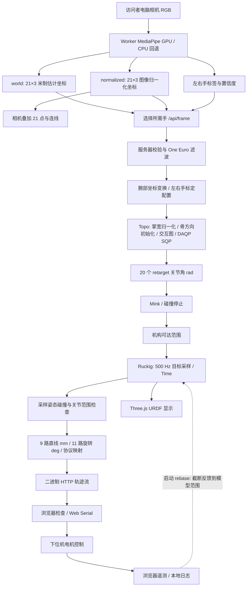

# A3.0 手势响应优化与延迟回放

本次仅修改本地源码，未部署 node0、未启动真实电机。重启本地服务后参数生效。

## 参数变化

A3.0 手势控制的加速度由 10 调整为 15 rad/s²，jerk 由 80 调整为 120 rad/s³。
速度仍为 swing 1.5 rad/s，其余 2.5 rad/s。保留 20 DOF `Synchronization.Time`。
在线动作回放使用共享函数的默认 10/80，不随此次手势参数调整。

Ruckig 的计算组织和同步策略是两个不同维度：

| 方式 | 行为 | 适用性与代价 |
|---|---|---|
| 每轴一个 1-DOF 实例 | 各轴独立到达目标 | 跟踪时短行程轴不等待长行程轴；多次 Python 调用，需自行统一时间与状态 |
| 一个 20-DOF 实例，Time | 同步到达，受约束最紧轴影响 | 动作整齐，连续变化的手势可能出现跨指耦合和较大相位差 |
| 一个 20-DOF 实例，None | 多轴一起计算但不要求同时到达 | 可减少跨轴等待，仍可统一状态和采样；值得与 Time 回放对比 |
| Phase | 尽可能同步运动相位 | 不是 Time 的同义词；涉及关节空间路径形状 |

Ruckig 本身不检查手指碰撞，Time 同步也不保证无碰撞。切换同步模式会改变中间路径，必须保留采样碰撞检查。本次只分析，未更改同步策略。
官方说明：<https://docs.ruckig.com/tutorial.html>。

## 数据通路



0 为手腕；1–4 拇指；5–8 食指；9–12 中指；13–16 无名指；17–20 小拇指。
normalized 数据不被当作米制三维坐标直接控制电机；主要空间求解使用 world。
这里的反馈箭头用于启动对齐与监控，不表示上位机持续位置闭环。

## 测量与加速结果

输入：本机 Downloads 中 `hand_control_20260921_203818_978000.jsonl`。
675 条识别记录、533 条 retarget 记录。历史记录中：

| 阶段 | 中位 ms | P95 ms |
|---|---:|---:|
| MediaPipe 推理 | 13.30 | 28.36 |
| 记录的 solve_ms（包含目标碰撞处理） | 20.20 | 23.95 |
| 推理后到响应记录（包含上一行，不能重复相加） | 23.80 | 27.44 |
| 同帧匹配的推理＋响应记录 | 38.10 | 52.74 |

最大推理 716.2 ms 发生于第一条识别记录；不能将启动尖峰当作持续耗时。
这些时间不包括完整的曝光等待、USB 写入完成到固件执行、机械响应。
没有固件回执时间戳，不能从 host write 推断电机已经执行。

本机无真机回放前 150 个有效左手原始输入，保留原时间戳与滤波状态，前 10 帧排除于稳态统计。
关闭碰撞、启用 Mink 各测一次，未插桩耗时与 cProfile/VizTracer 分开测量。

| 本机 WebSession.process | 修改前中位 ms | 修改后中位 ms | 改善 |
|---|---:|---:|---:|
| off | 13.29 | 11.36 | 14.5% |
| mink | 13.68 | 11.41 | 16.6% |

改动：交互图 21×21 距离权重批量求值，手掌坐标系固定 3-vector 叉积去除通用广播开销。
保留 Delaunay 拓扑、邻居顺序、阈值、目标函数、迭代次数、解析 Jacobian 与全部关节限制。
off/mink 各 150 帧的原始 retarget 角输出前后逐项一致，最大和 RMS 角差均为 0。
这仅是该数据集的验证，不是所有未来输入的精度保证；本机提速不能直接等同 node0 提速。

43 项测试通过，包括 Ruckig 目标反向变化时速度/加速度/jerk 上界、反馈转换、协议兼容、FK/Jacobian 与交互图稳定性。

## 火焰图与下一步

报告：`logs/retarget_profile/report.html`。
真实调用栈聚合火焰图：`logs/retarget_profile/flamegraph.svg`（悬停显示函数路径）。
可缩放调用栈时间线：`logs/retarget_profile/after/flamegraph.html`。
原始测量与精度差：各子目录的 `metrics.json`、`hotspots.txt`、`profile.pstats` 和 `accuracy.json`。

火焰图来自真实 VizTracer 栈事件，宽度是带插桩开销的累计时间，不是 CPU 采样次数。
聚合图去除初始化与前 10 帧。父子调用时间相互包含，不能相加。
覆盖 WebSession 的滤波、retarget、目标碰撞、转换，不覆盖浏览器 GPU、网络、USB 或独立 500 Hz 线程。

改后 cProfile 显示 retarget 约占 process 累计时间的 88%；重点仍是 DAQP 外层残差求值、FK/Jacobian、骨方向初始化。
本数据段 Mink 较轻，不代表手指密集接触时也同样轻。下一步应优先减少重复 FK/残差计算，接着比较统一实例 Time/None 的运动跟随误差，单独分析 GPU 推理尖峰。
计算耗时、滤波相位延迟、Ruckig 轨迹滞后、机械滞后是不同指标。

在 hand_dex 环境下从项目根目录复现（不连接串口）：

```powershell
python tools/profile_web_retarget.py --input "C:\Users\ONKIALL\Downloads\hand_control_20260921_203818_978000.jsonl" --output logs/retarget_profile/new_run --trace
```

`before`/`after` 是本次保留的结果；重新执行当前代码不能生成旧实现的基线。
已有这两个目录和 `after/trace.json` 时可运行 `python tools/render_retarget_profile.py` 重建报告。
