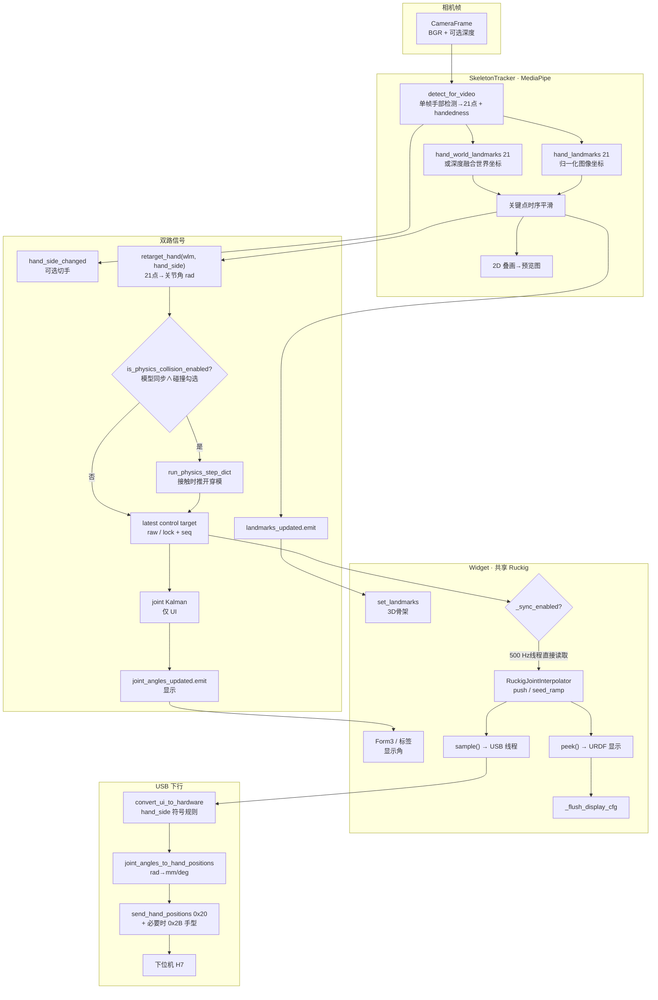
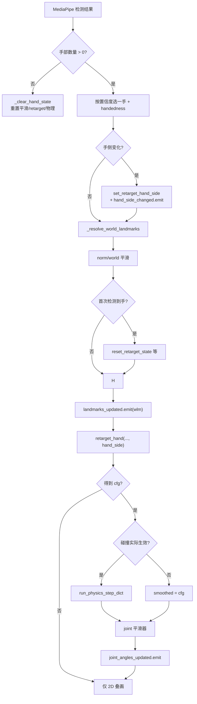
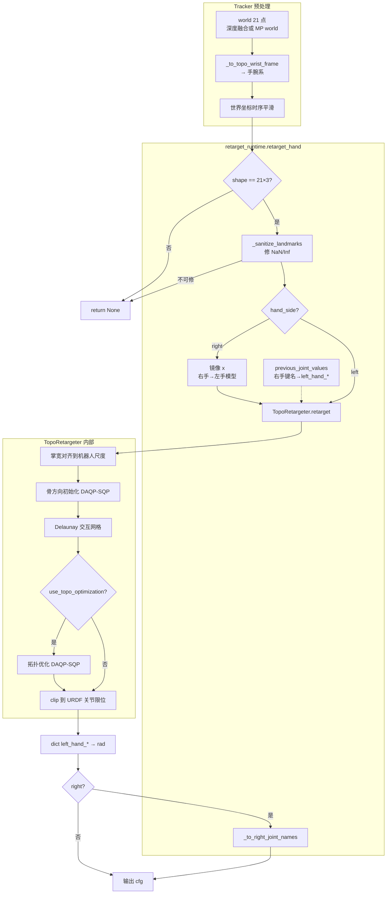
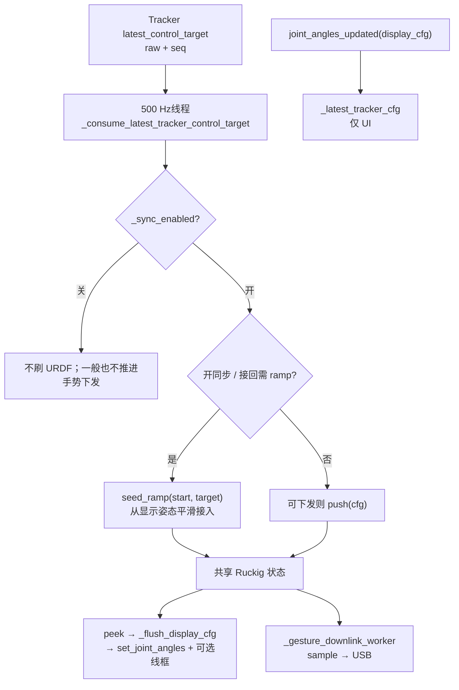
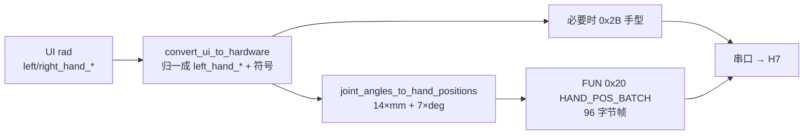
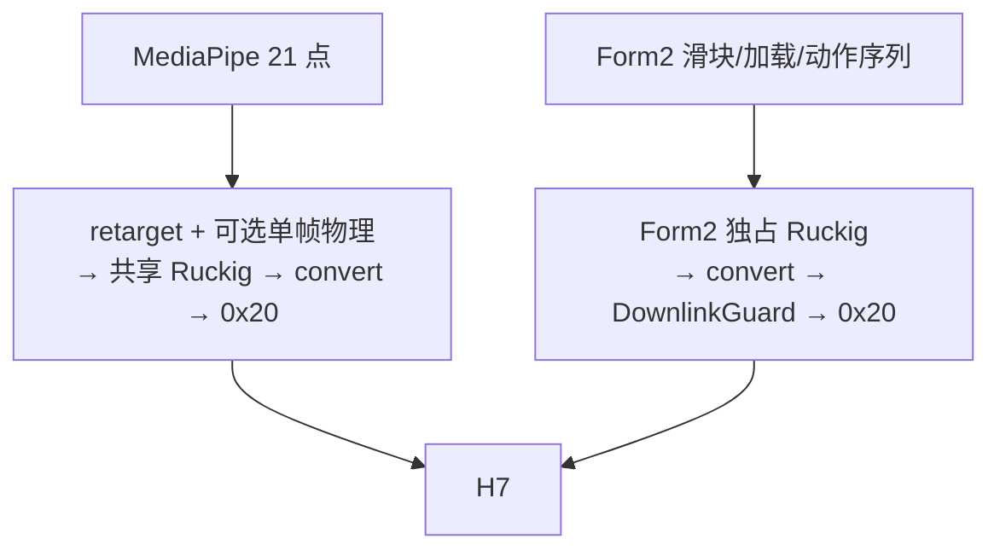

# MediaPipe 21 关键点之后的数据流

本文描述程序启动后，从 **MediaPipe Hand Landmarker 输出 21 个关键点** 起，到主界面 URDF 显示与 USB 下发 H7 为止的数据路径。

> 输入源扩展：主界面现可在“本机视觉”和“CloudXR Quest 3”之间切换。CloudXR/OpenXR 26 点会先映射成 MediaPipe 顺序的 21 点，再从 `_apply_hand_landmarks` 进入本文所述的同一条链路；原本的本机视觉功能仍为默认项。协议见 [`cloudxr_quest3_input.md`](cloudxr_quest3_input.md)。

**一句话结论：**  
模型同步开启后，**显示与下发共用同一条 Ruckig 轨迹**——Tracker 关键帧经 retarget（+可选碰撞）后写入线程安全“最新目标槽”，500 Hz 下行线程直接 `push` 进 Ruckig，不经过 Qt 主线程；URDF 用 `peek()` 读当前态，USB 线程用 `sample()` 推进并下发。H7 收到的已经是 Ruckig 平滑后的目标，而不是 MediaPipe/retarget 的瞬时跳变值。

对应实现主要落在：

| 阶段 | 文件 |
|------|------|
| 推理与后处理 | [`src/skeleton/tracker.py`](../src/skeleton/tracker.py) |
| 重定向（Topo） | [`src/utils/retarget_runtime.py`](../src/utils/retarget_runtime.py)、[`TsenseI_retargeting/toporetarget.py`](../TsenseI_retargeting/toporetarget.py) |
| MuJoCo 碰撞投影 | [`src/physics/mujoco_filter.py`](../src/physics/mujoco_filter.py) |
| 主窗闸门 / 显示 / 共享轨迹 | [`src/app/widget.py`](../src/app/widget.py) |
| Ruckig 插补 | [`src/utils/ruckig_interpolator.py`](../src/utils/ruckig_interpolator.py) |
| UI→HW 符号 | [`src/protocol/hand_angle_protocol.py`](../src/protocol/hand_angle_protocol.py) |
| 关节角 → 硬件包 | [`src/usb/offline.py`](../src/usb/offline.py)、[`src/kinematics/finger_linkage.py`](../src/kinematics/finger_linkage.py) |

---

## 0. 函数速查（名称 → 干什么）

| 函数 / 信号 | 所在模块 | 作用 |
|-------------|----------|------|
| `detect_for_video` | MediaPipe API | 对单帧 RGB 做手部检测，输出 21 点归一化坐标与世界坐标 |
| `_process_mediapipe` | `SkeletonTracker` | 相机帧入口：调 MediaPipe、统计手数、解析 handedness、进入关键点后处理 |
| `_resolve_world_landmarks` | `SkeletonTracker` | 决定用深度融合还是 MediaPipe world 作为 21 点世界坐标 |
| `_apply_hand_landmarks` | `SkeletonTracker` | 平滑关键点、重定向、可选碰撞、发布 raw 控制目标及 UI 信号、画 2D 叠图 |
| `_clear_hand_state` | `SkeletonTracker` | 手消失时重置平滑器 / retarget / 物理，并清空 landmark 信号 |
| `hand_side_changed` | Signal | 左右手切换时通知主窗换 URDF / init / 标签 |
| `set_retarget_hand_side` | `retarget_runtime` | 更新重定向活动手侧；切手时清 warm-start |
| `retarget_hand` | `retarget_runtime` | **21 世界坐标点 → `{关节名: rad}`**；右手先镜像关键点再映射为 `right_hand_*` |
| `is_physics_collision_enabled` | `tracker` | 「模型同步 ∧ 碰撞勾选」是否同时生效 |
| `run_physics_step_dict` | `tracker` → MuJoCo | 对当前关节姿态做物理步进，接触时把关节推到无穿模位姿 |
| `landmarks_updated` | Signal | 把 21 世界坐标点发给主窗 3D 骨架 / Form3 |
| `joint_angles_updated` | Signal | 仅把 joint Kalman 后的显示角发给 Qt 主窗 / Form3 |
| `_on_landmarks_updated` | `Widget` | 收到关键点：刷新 `HandSkeletonGLWidget`（及可见的 Form3） |
| `latest_control_target` | `SkeletonTracker` | 线程安全读取最新 raw 控制目标；按序号丢弃旧帧，不走 Qt 队列 |
| `_consume_latest_tracker_control_target` | `Widget` | 500 Hz 下行线程直接消费最新目标并 `push`/`seed_ramp` 进 **共享 Ruckig** |
| `_on_joint_angles_updated` | `Widget` | Qt 显示路径：更新 Form3 / 标签，不再驱动下发目标 |
| `_should_gesture_usb_downlink` | `Widget` | 是否允许手势路径推进 Ruckig / 下发（同步开，且 Form2 未抢占） |
| `RuckigJointInterpolator.push` | `ruckig_interpolator` | 异步更新目标；内部 canonical 为 `left_hand_*`，自动接受 `right_hand_*` |
| `RuckigJointInterpolator.sample` | `ruckig_interpolator` | 下行线程推进 1 步（默认 ~2 ms），返回当前手侧键名的关节角 |
| `RuckigJointInterpolator.peek` | `ruckig_interpolator` | 只读当前态（不推进），供 URDF / 线框与 USB **同源** |
| `RuckigJointInterpolator.seed_ramp` | `ruckig_interpolator` | 从已知姿态启动轨迹（开同步 / 回零结束 / 接回） |
| `_flush_display_cfg` | `Widget` | 定时器：用 Ruckig `peek()` 刷 URDF + 可选胶囊线框 |
| `_gesture_downlink_worker` | `Widget` | 后台按 `DOWNLINK_HZ`：`sample()` → `convert_ui_to_hardware` → `send_joint_angles` |
| `convert_ui_to_hardware` | `protocol` | UI rad → HW rad（按左右手改符号；键名归一成 `left_hand_*`） |
| `send_joint_angles` | `UsbController` | **已是 HW 空间**的关节角 → mm/deg 打包；可写 0x2B 手型 |
| `joint_angles_to_hand_positions` | `offline` / linkage | 转角→直线 mm、旋转关节→deg |
| `send_hand_positions` | `UsbController` | 打包 `FUN 0x20 HAND_POS_BATCH` 经串口发给 H7 |

---

## 1. 总览（21 点 → 显示 / 下位机）



### Ruckig 接管含义

| 路径 | 谁推进 | 谁读状态 |
|------|--------|----------|
| URDF / 碰撞线框 | 下行线程 `sample()` 推进内部态 | 主线程 `peek()`（只读） |
| USB → H7 | 同一 `sample()` 的返回值 | 立刻 `convert` + `send` |

因此：**只要模型同步开着，下发数据已被 Ruckig 接管**；碰撞只改变进入 Ruckig 的关键目标，不会在 500 Hz 热路径上再解一次碰撞。

---

## 2. Tracker 内部：拿到 21 点之后

入口：`_process_mediapipe` → `_apply_hand_landmarks`。



要点：

- **归一化 21 点**：2D 预览叠画。
- **世界坐标 21 点**：`retarget_hand` + `landmarks_updated`（3D 骨架）。
- **碰撞**：仅「模型同步 ∧ 碰撞勾选」时对 **关键帧** 投影；Ruckig/USB **不再**重复求解。
- **左右手**：右手在 retarget 内镜像关键点，输出 `right_hand_*`；Ruckig 内部仍用 `left_hand_*` canonical，`peek`/`sample` 再按手侧还原键名。

---

## 3. 重定向：21 点 → 关节角

**目标：** 把 MediaPipe Hands 的 **21 个世界坐标关键点**（米制）求解成机器人手 **21 个可控关节角**（弧度），供后续碰撞投影、Ruckig、URDF 显示与 USB 下发使用。

当前默认算法为 **Topo**（`TsenseI_retargeting.TopoRetargeter`），由 [`src/utils/retarget_runtime.py`](../src/utils/retarget_runtime.py) 包装后供 Tracker 调用。



---

### 3.1 在整条链路中的位置

入口在 Tracker 的 `_apply_hand_landmarks`（[`src/skeleton/tracker.py`](../src/skeleton/tracker.py)）：

1. 已拿到 **平滑后的世界坐标 21 点**（深度反投影优先，否则 MediaPipe `hand_world_landmarks`）。
2. MediaPipe 世界系再经 `_to_topo_wrist_frame` → `apply_mediapipe_transformations`，变换到 **Topo 期望的手腕坐标系**（与旧 TsenseI OPERATOR2MANO 约定一致）。
3. 调用：

```python
cfg = retarget_hand(
    wlm,                          # list[(x,y,z)]，长度 21
    frame_id=frame_id,
    previous_joint_values=prev,   # 上一帧 raw 关节角：warm-start + 欠观测选解先验
    hand_side=self._current_hand_side,
)
```

4. 若 `cfg` 非空：可选 MuJoCo 碰撞投影 → raw 结果发布到最新控制目标槽；另复制一份经过 joint Kalman 后 `joint_angles_updated.emit(display_cfg)`，只供 UI。

关键点掌宽、指尖长度或展开度不合格时直接丢弃该帧，不发布 init 伪目标，也不进入 retarget；首个质量合格帧立即接入，因此没有固定等待 3 帧的主动延迟。

**输入形态：** `21 × (x, y, z)`，单位 **米**，MediaPipe Hands 顺序。  
**输出形态：** `{关节名: float}`，单位 **rad**；左手键名 `left_hand_*`，右手键名 `right_hand_*`。

若形状不对、关键点不可修复、或 Topo 未初始化成功，则 `retarget_hand` 返回 `None`，本帧只做 2D 叠画，不发关节角。

---

### 3.2 MediaPipe 21 点编号（求解器硬约定）

与 [`TsenseI_retargeting/landmarks.py`](../TsenseI_retargeting/landmarks.py) / MediaPipe Hands 一致：

| ID | 名称 | 链 |
|----|------|-----|
| 0 | Wrist | 掌根 |
| 1–4 | ThumbCMC → Tip | 拇指 |
| 5–8 | IndexMCP → Tip | 食指 |
| 9–12 | MiddleMCP → Tip | 中指 |
| 13–16 | RingMCP → Tip | 无名指 |
| 17–20 | PinkyMCP → Tip | 小指 |

骨架边：每指链上相邻点 + 腕到各指根（`SKELETON_EDGES` / `ROOTED_FINGER_CHAINS`）。  
**掌宽**定义为 `‖IndexMCP(5) − PinkyMCP(17)‖`，用于人手→机器人尺度对齐；**不要**靠整体缩放关键点 YAML 来“拉大手”。

---

### 3.3 机器人侧资产与 21 个优化 DOF

Topo 启动时从 `HAND_MODEL_DIR`（默认 [`assets/hands/TsenseI_hand`](../assets/hands/TsenseI_hand)）加载：

| 文件 | 作用 |
|------|------|
| `eval_config.yaml` | `urdf_path`、`keypoint_config`、`active_joints` |
| URDF | 连杆/关节限位；FK 与解析雅可比共用 |
| `robot_keypoints_21.yaml` | 每个 MediaPipe id(0..20) 绑定到某 link + `local_xyz`（米，相对该 link） |

`active_joints`（共 **21** 个，与默认 `JOINT_NAMES` 一致）：

| 手指 | 关节 |
|------|------|
| 拇指 | `thumb_rota`, `thumb_swing`, `thumb_MCP`, `thumb_PIP` |
| 食/中/无名 | 各 `swing` + `MCP` + `PIP` + `DIP` |
| 小指 | `pinky_rota`, `pinky_swing`, `pinky_MCP`, `pinky_PIP`, `pinky_DIP` |

全部带 `left_hand_` 前缀。求解器 **只在左手模型上优化**；右手通过关点镜像 + 输出键名改写实现（见 3.5）。

**FK：** `RobotKeypointFK` 对给定 `q` 做 URDF 正运动学，把 21 个标定关键点变到基座系，再减腕点得到掌心相对坐标。可选 **Pinocchio** 解析雅可比；不可用则回退有限差分。

---

### 3.4 `retarget_runtime`：统一入口与状态机

模块级单例：`TopoRetargeter` 实例、`_active_hand_side`、上一帧有效关键点、求解锁。Form3 可调参数写入 `TopoRetargetConfig`（frozen），变更时 **重建 retargeter 并尽量保留 warm-start**（`previous_q` / `previous_init_q`）。

#### 3.4.1 关键点消毒 `_sanitize_landmarks`

任一坐标为 NaN/Inf 时：

1. 优先用 `_last_valid_landmarks` 同索引替换；
2. 否则沿 MediaPipe 父子链（`_MP_PARENT`：指尖→…→腕）找最近有限父节点：若有历史帧，用「父点 + 历史骨向量」重建，否则直接贴到父点；
3. 仍无法修则整帧失败，并对 Topo `reset()`（清 warm-start）。

全部有限后更新 `_last_valid_landmarks`。

#### 3.4.2 左右手：镜像输入、改写输出

机器人资产只有左手 URDF。右手路径：

1. **`_mirror_world_landmarks_for_right`**：`keypoints[:, 0] *= -1`（镜像 x），使右手姿态可喂给左手模型；
2. **`previous_joint_values`** 若是 `right_hand_*`，仅 `_to_left_joint_names`，保持关节数值；
3. 求解得到 `left_hand_*` 后，仅 **`_to_right_joint_names`** 改名前缀返回。左右 URDF 在相同关节值下互为镜像；不能再次翻转 `thumb_swing`。UI/URDF/H7 的 `thumb_swing` 统一为 `[0,2]rad`，下发同值。`pinky_rota` 的硬件取负仍在协议层处理，**thumb_rota 同号**。

`set_retarget_hand_side` 在左右手切换时调用 `reset_retarget_state()`，避免跨手侧 warm-start 串味。

#### 3.4.3 失败判定 `_topo_solver_failed`

仅在硬失败（如 residual 非有限、`DAQP failed`）时 `reset()`。  
「迭代打满」「stalled after improvement」「warm-start」等 **不**清状态，以免实时抖动后从零重启。

#### 3.4.4 Tracker 侧暖启动语义

| 事件 | 行为 |
|------|------|
| 首次检出 / 再现 | `reset_retarget_state()`；关节平滑从 init seed；`previous` 先用 init |
| 正常跟随 | `previous_joint_values = _last_control_cfg`（raw，不经过 joint Kalman） |
| 短暂丢检（&lt; 8 帧） | 不清 retarget；可继续发上一帧关节角 |
| 持续丢检 | `reset_retarget_state()`；清 warm-start，再现从 init 冷启动 |

---

### 3.5 `TopoRetargeter.retarget` 逐步算法

实现：[`TsenseI_retargeting/toporetarget.py`](../TsenseI_retargeting/toporetarget.py)。  
核心思想：**不直接拟合绝对关键点位置**（人手与机器人比例、标定误差大），而是匹配 **相对骨方向** 与 **掌心拓扑（Delaunay Laplacian）**，并在关节限位内用 DAQP 做有约束 SQP。

#### 步骤 A — 尺度对齐 `_source_points_in_robot_scale`

对输入人手点 `S`：

\[
S' = (S - S_{\mathrm{wrist}}) \cdot \frac{w_{\mathrm{robot}}}{w_{\mathrm{human}}}
\]

其中 \(w = \|\mathrm{IndexMCP}-\mathrm{PinkyMCP}\|\)，\(w_{\mathrm{robot}}\) 在 **零位** 用机器人 FK 关键点算一次并缓存。此后人手与机器人都在「腕为原点、掌宽可比」的空间里比较。

#### 步骤 B — 掌心规范坐标与骨项

- **`_hand_frame`**：用 IndexMCP−PinkyMCP（掌横向）、MiddleMCP−Wrist（掌前向）叉积得掌法向，组成掌心坐标系。
- **`_canonical_hand_points`**：把点变到该掌心系（拓扑残差用；机器人侧用 **零位** 掌心系固定，避免随姿态乱转）。
- **`_relative_bone_terms`**：在掌心系下，对每条「带腕指链」相邻骨方向之差  
  \(d_i - d_{i+1}\)（单位方向），作为初始化与拓扑阶段的骨向目标。

拇指根边 `(0→1)`、`(1→2)` 的骨向残差乘以 \(\sqrt{\texttt{thumb\_root\_bone\_weight}}\)（默认 **1.0**，与 Quest v3 原版等权）。

#### 步骤 C — 交互网格 `_build_interaction_graph`

对尺度对齐后的人手点做 **3D Delaunay** 四面体剖分，取所有四面体边构成无向图。  
边权（对每个顶点邻域归一化）：

\[
w_{ij} \propto \exp\!\left(-\kappa \frac{\|p_i-p_j\|^2}{w_{\mathrm{robot}}^2}\right)
\]

`κ`（默认 30）越大，远端邻接贡献越弱。  
再算人手点的 **Laplacian 坐标** \(\delta_i = \sum_j w_{ij}(p_i-p_j)\)，作为拓扑形状目标。

#### 步骤 D — 骨方向初始化（warm-start）

目标残差拼接：

\[
r_{\mathrm{init}} =
\begin{bmatrix}
\sqrt{\lambda_{\mathrm{warm}}}\, r_{\mathrm{bone}}(q) \\
\sqrt{\lambda_{\mathrm{smooth}}}\,(q - q_{\mathrm{prior}})
\end{bmatrix}
\]

- \(q_{\mathrm{prior}}\)：上一帧的 `previous_init_q`，否则使用全零 init；
- 用 **DAQP** 解阻尼 Gauss–Newton QP：\(H = J^\top J + d I\)，\(g = J^\top r\)，步长 \(\Delta q\) 限制在关节限位与 `daqp_init_step_limit_rad` 内；
- 线搜索 \(\alpha \in \{1, 1/2, \ldots, 1/16\}\)，接受使 \(\tfrac12\|r\|^2\) 下降的步；
- 实时默认 `init_max_iters=1`（Form3 可调高）。

得到 \(q_{\mathrm{init}}\)。

#### 步骤 E — 拓扑优化（可选）

`use_topo_optimization=True`（默认）时，残差变为：

\[
r =
\begin{bmatrix}
\sqrt{\lambda_{\mathrm{im}}}\, r_{\mathrm{IM}}(q) \\
\sqrt{\lambda_{\mathrm{bone}}}\, r_{\mathrm{bone}}(q) \\
\sqrt{\lambda_{\mathrm{init}}}\,(q - q_{\mathrm{init}}) \\
\sqrt{\lambda_{\mathrm{reg}}}\,(q - q_{\mathrm{prev}})
\end{bmatrix}
\]

| 项 | 含义 | 实时默认权重 |
|----|------|----------------|
| \(r_{\mathrm{IM}}\) | 机器人点（固定零位掌心系）的 Laplacian 与人手 \(\delta\) 之差（软 L2 + ε） | `lambda_im=12` |
| \(r_{\mathrm{bone}}\) | 相对骨方向差（含拇指根加权） | `lambda_bone=0.5` |
| \(q-q_{\mathrm{init}}\) | 勿漂离初始化 | `lambda_init=0.1` |
| \(q-q_{\mathrm{prev}}\) | 21点欠观测下选择连续的逆解分支 | V2 实时 `lambda_reg=0.1` |

初值选择：若存在 `previous_q`，比较 \(q_{\mathrm{init}}\) 与 \(q_{\mathrm{prev}}\) 谁残差更小，选更好的作为 SQP 起点（diagnostics 记 `initial_guess`）。

同样 DAQP-SQP；实时默认 `topo_max_iters=2`，步长上限 `daqp_topo_step_limit_rad=0.15`，与 Quest v3 原版一致。

`use_topo_optimization=False` 时直接采用 \(q_{\mathrm{init}}\)（更快、更跟手，形状贴合略差）。

#### 步骤 F — 输出与状态更新

1. `q_opt = clip(q, lower, upper)`（URDF 限位）；
2. 更新 `previous_init_q`、`previous_q` 供下一帧；
3. 返回 `TopoRetargetResult`：
   - `joint_values`：`{left_hand_*: rad}`
   - `robot_keypoints_21`：当前 `q` 下机器人腕相对 21 点（诊断模式生成）
   - `source_keypoints_21_robot_scale`：对齐尺度后的人手点（诊断模式生成）
   - `loss` / `diagnostics`：分项能量与迭代信息；实时关闭 pipeline log 时跳过未消费的完整 loss/FK 构造

`retarget_hand` 只把 `joint_values`（必要时改成 `right_hand_*`）交给 Tracker。

---

### 3.6 实时可调参数（Form3 → `TOPO_PARAM_SPECS`）

| 键 | 含义 | 实时默认 |
|----|------|----------|
| `use_topo_optimization` | 是否跑拓扑阶段 | 开 |
| `lambda_warm` / `lambda_smooth` | 初始化骨向 / 欠观测选解先验 | 2.0 / 0.1 |
| `lambda_im` / `kappa` | 交互网格强度 / 边衰减 | 12 / 30 |
| `interaction_graph_ema_alpha` | Delaunay 邻接/边权跨帧稳定系数；不平均 landmark 或关节角 | 0.5 |
| `lambda_bone` | 拓扑阶段骨向 | 0.5 |
| `thumb_root_bone_weight` | 拇指根骨向倍率 | 1.0 |
| `lambda_init` / `lambda_reg` | 贴 init / 欠观测选解先验 | 0.1 / 0.1 |
| `init_max_iters` / `topo_max_iters` | 两阶段迭代上限 | 2 / 3 |
| `ftol` | 步长 ∞-范数收敛阈 | 1e-5 |
| `daqp_hessian_damping` | \(J^\top J\) 阻尼 | 1e-6 |
| `daqp_*_step_limit_rad` | 每步关节增量上限 | init 0.35 / topo 0.15 |

设计取向：求解权重、收敛阈值和步长与 Quest v3 原版对齐；实时性能由解析 Jacobian、热启动和跳过未消费诊断产物保证。
`interaction_graph_ema_alpha` 越小越抑制 Qhull 边翻转尖峰，越大越快跟随交互拓扑变化；`1.0` 可恢复未稳定化的逐帧图行为。

---

### 3.7 输出之后（本节边界）

重定向产出的 `cfg` **还不是**最终下位机指令：

1. 可选 `run_physics_step_dict`（模型同步 ∧ 碰撞勾选）推开穿模；
2. raw 结果进入线程安全最新目标槽 → 500 Hz 下行线程 → **共享 Ruckig**（§4）；
3. Tracker `_joint_smoother` 只处理 Qt/UI 副本，不进入控制链；retarget 内保留 Quest v3 原版的上一帧逆解先验，用来排除21点欠约束的错误解分支，不承担速度/加速度平滑；
4. USB 前再经 `convert_ui_to_hardware` 改符号 / 键名（§5）。

本节只负责：**手腕系 21 点 → UI 空间关节角字典**。

---

### 3.8 实现文件速查

| 职责 | 路径 |
|------|------|
| Tracker 调用 / 手腕系 / 暖启动 | [`src/skeleton/tracker.py`](../src/skeleton/tracker.py) |
| 统一入口、镜像、消毒、参数 | [`src/utils/retarget_runtime.py`](../src/utils/retarget_runtime.py) |
| Topo 求解器 | [`TsenseI_retargeting/toporetarget.py`](../TsenseI_retargeting/toporetarget.py) |
| 21 点拓扑常量 | [`TsenseI_retargeting/landmarks.py`](../TsenseI_retargeting/landmarks.py) |
| URDF FK + 关键点 YAML | [`TsenseI_retargeting/fk/`](../TsenseI_retargeting/fk/) |
| 手模资产 | [`assets/hands/TsenseI_hand/`](../assets/hands/TsenseI_hand/) |

---

## 4. 主窗口：信号之后 — 共享 Ruckig



### 开同步首帧（防跳动）

1. `_prepare_sync_activation`：抓 **当前显示姿态**（不是瞬时 tracker）  
2. `reset` + `seed_ramp(start, start)` 稳住  
3. 首个真实手势帧：`seed_ramp(start, cfg)`，再进入在线 `push`

### `_gesture_downlink_worker`（~500 Hz）

即使未连串口也会 `sample()`，保证屏幕与「若连接则下发」的状态一致。

1. 每个 tick 先读取一次 `latest_control_target(last_seq)`；仅新序号会 `push`，不会排队旧视觉帧
2. `_should_gesture_usb_downlink()` 为真时 `sample()`
3. 若 `usb.should_process_downlink`：
   `convert_ui_to_hardware(cfg, hand_side=...)` → `send_joint_angles(..., hand_side=...)`

---

## 5. USB：关节角 → 电机指令

调用约定：**先** `protocol.convert_ui_to_hardware`，**再** `UsbController.send_joint_angles`（后者不再做 UI↔HW 变号）。



### 键名「只用 left_hand_*」

打包表 `JOINT_ORDER` / 电机槽位写死 `left_hand_*`。  
`convert_ui_to_hardware` 会把 `right_hand_*` **改名**为对应 `left_hand_*`，再按 `hand_side` **改符号**。  
左右手差别是 **数值正负 + 0x2B**，不是两套帧布局。

### 左右手符号（摘要）

| 关节 | 左手 HW | 右手 HW |
|------|---------|---------|
| 四指 swing | 与 UI 同号并截断 → `[0.5°,39.5°]` | 与 UI 同号 → `[0,+0.696rad]` |
| thumb_rota | 与 UI 同号，无系数；直接钳到 `[0.5°,89.5°]` | **同左手** |
| pinky_rota | 正 | 取负 |
| thumb_swing | 同值 `q` → `[0,2]rad` | 同值 `q` → `[0,2]rad`（MediaPipe求解结果仅改键名前缀） |
| MCP/PIP/DIP → mm | 弯曲为负 mm | 同左手 |

H7 协议约定：旋转 **顺时针为正、逆时针为负**（见 `usb/offline.py` 文件头）。
URDF/retarget 中的正角遵循关节局部轴右手定则；顺逆时针必须指定观察轴方向，不能仅由正负号脱离坐标轴判断。

---

## 6. 数据形态速查

| 节点 | 形态 | 坐标系 / 空间 |
|------|------|----------------|
| MediaPipe norm | 21 × Landmark | 图像归一化 [0,1] |
| MediaPipe / 深度 world | 21 × (x,y,z) | 米制世界 / 相机相关 |
| `retarget_hand` 输出 | `{joint_name: rad}` | UI；左手 `left_hand_*`，右手 `right_hand_*` |
| `run_physics_step_dict` 后 | 同上，可能被推开 | 与 UI 同键名 |
| Ruckig 内部 | canonical `left_hand_*` | jerk-limited 轨迹态 |
| `peek` / `sample` | 按当前手侧键名 | UI 空间 rad |
| `convert_ui_to_hardware` 后 | `left_hand_*` | **硬件约定**符号 rad |
| `send_hand_positions` | mm + deg 数组 | 直线 / 旋转电机指令 |

---

## 7. 碰撞对下发的影响

| 条件 | 效果 |
|------|------|
| 仅勾选碰撞、同步关 | 碰撞不跑；手势一般也不下发 |
| 同步开、碰撞关 | retarget 原样 → Ruckig → H7 |
| 同步开、碰撞开 | retarget → **MuJoCo 投影** → Ruckig → H7 |

帧格式不变；变的是进入 Ruckig 的关键目标角（有穿透时会被推开）。

---

## 8. 与 Form2 路径的关系（对照）



- 手势主路径：**Ruckig 接管**显示与下发。  
- Form2：**不经 MediaPipe，也不复用手势 Ruckig 状态**；实时滑块、加载动作、动作序列使用
  Form2 独占的 `RuckigJointInterpolator + DownlinkGuard`，并与手势链互斥。串口写失败时
  Ruckig/Guard 回退到最后成功下发姿态，恢复写入不会一次补发累计位移。
- 找零、校准和“五指往返”是电机命令/毫米行程诊断，不属于整手关节角轨迹入口。

---

## 9. 相关时序常量

见 [`src/utils/hand_init.py`](../src/utils/hand_init.py)：

| 常量 | 含义 |
|------|------|
| `INIT_RETURN_TRANSITION_S` | 手消失 → init |
| `HAND_RESUME_TRANSITION_S` | 开同步 / 碰撞暖启动接入 |
| `HAND_REAPPEAR_TRANSITION_S` | 手再现 init → 首帧 |
| `HAND_REAPPEAR_HANDOVER_S` | 首帧 → 实时跟随交接 |
